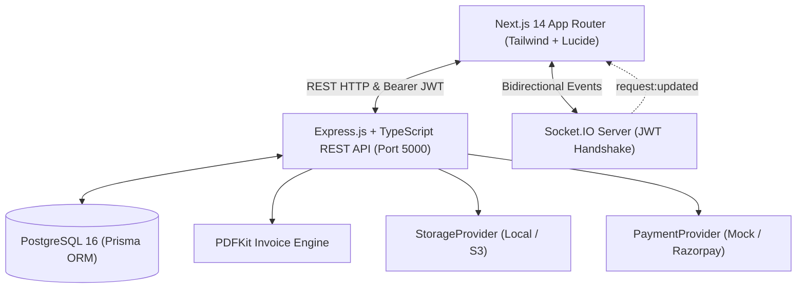
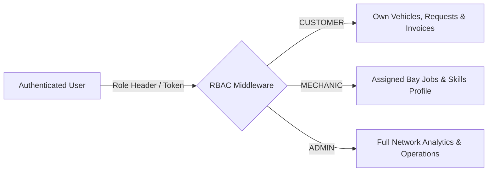
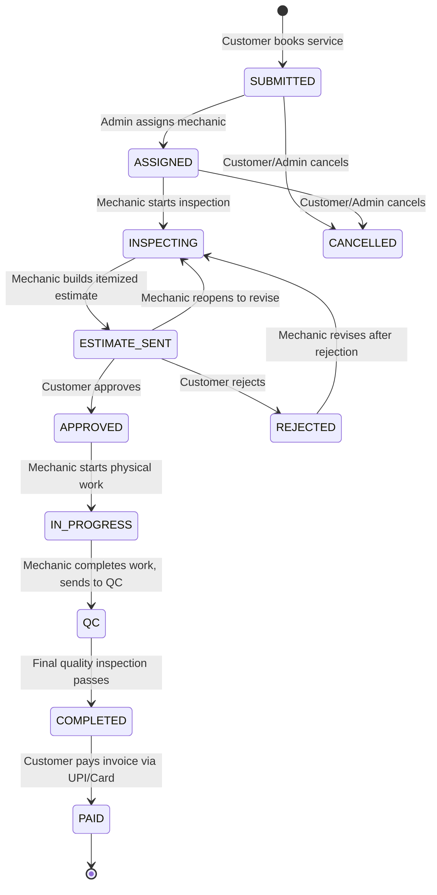

# 📘 RepairHub — Comprehensive Product & Feature Documentation

> **RepairHub** is a production-grade vehicle repair and service management platform designed for independent garages in India (pilot deployment: Tier-2 cities such as Kanpur). It replaces phone calls, handwritten job cards, and verbal estimates with a transparent, digital workflow connecting **Vehicle Owners (Customers)**, **Mechanics**, and **Garage Network Admins**.

---

## 📑 Table of Contents
1. [Platform Architecture & Tech Stack](#1-platform-architecture--tech-stack)
2. [Roles & Permission Model (RBAC)](#2-roles--permission-model-rbac)
3. [The 9-Stage State Machine & Workflow](#3-the-9-stage-state-machine--workflow)
4. [Customer Portal Features](#4-customer-portal-features)
5. [Mechanic Portal Features](#5-mechanic-portal-features)
6. [Admin Operations Portal Features](#6-admin-operations-portal-features)
7. [Smart Mechanic Assignment Engine](#7-smart-mechanic-assignment-engine)
8. [Billing, Invoices & Indian Localization](#8-billing-invoices--indian-localization)
9. [Real-Time WebSocket Synchronization](#9-real-time-websocket-synchronization)
10. [Security & Architectural Guardrails](#10-security--architectural-guardrails)
11. [Production Extension Points](#11-production-extension-points)
12. [Demo Logins & Verification Checklist](#12-demo-logins--verification-checklist)

---

## 1. Platform Architecture & Tech Stack

RepairHub is architected as a clean TypeScript monorepo with strict separation of concerns between client, API, database, and background services.



### Technology Highlights
- **Frontend**: Next.js 14 (App Router) + TypeScript + Tailwind CSS with dark navy (`#0B1729`), high-vis orange (`#FF8A3D`), and cyan (`#22C7DB`) palette.
- **Backend**: Node.js + Express + TypeScript in `/backend` with modular architecture.
- **Database & ORM**: PostgreSQL 16 with Prisma ORM; versioned SQL migrations and strict indexation.
- **Real-Time Layer**: Authenticated Socket.IO with dynamic room partitioning (`user:<id>`, `role:admin`, `request:<id>`).
- **Validation**: Strict Zod schemas validating every incoming request body, query parameter, and route ID.
- **Testing**: Vitest + Supertest test suite with 100% passing unit and integration tests.

---

## 2. Roles & Permission Model (RBAC)

Every endpoint and data view enforces strict server-side role validation. Client-supplied IDs are never trusted for ownership verification.



### Role Capabilities Summary

| Capability | Customer | Mechanic | Admin |
| :--- | :---: | :---: | :---: |
| Self-Registration | ✅ | ❌ | ❌ (Seed only) |
| Manage Personal Vehicles | ✅ | ❌ | ❌ |
| Submit Repair Request | ✅ | ❌ | ✅ |
| View Request Details | Own Only | Assigned Only | All |
| Perform Diagnosis & Log Notes | ❌ | ✅ | ❌ |
| Create / Revise Estimates | ❌ | ✅ | ✅ |
| Approve / Reject Estimate | ✅ | ❌ | ✅ |
| Advance Repair Stages (`IN_PROGRESS → QC → COMPLETED`) | ❌ | ✅ | ❌ |
| Pay for Completed Repairs | ✅ | ❌ | ❌ |
| Download Digital Tax Invoice (PDF) | ✅ | ❌ | ✅ |
| Submit Rating & Review | ✅ | ❌ | ❌ |
| Raise / Resolve Complaints | Raise | ❌ | Resolve |
| Smart Mechanic Assignment | ❌ | ❌ | ✅ |
| Toggle Bay Availability & Skills | ❌ | ✅ | ❌ |
| Verify Garages & Onboard Mechanics | ❌ | ❌ | ✅ |
| Network-Wide Analytics | ❌ | ❌ | ✅ |

---

## 3. The 9-Stage State Machine & Workflow

RepairHub eliminates verbal disputes and unexpected repair bills through a strict, deterministic 9-stage state machine enforced in [`stateMachine.ts`](../backend/src/services/stateMachine.ts).



### State Definitions & Enforced Business Rules

1. **`SUBMITTED`**: Customer creates the service request specifying vehicle, category, and issue description. Awaiting garage assignment.
2. **`ASSIGNED`**: Admin assigns an available, certified mechanic using pure rule-based smart suggestions or manual pick.
3. **`INSPECTING`**: Vehicle arrives at the bay. Mechanic runs diagnostic scans and tests.
4. **`ESTIMATE_SENT`**: Mechanic builds a versioned, line-item estimate (parts & labour).
   > **Revision Loop**: Mechanics may reopen `ESTIMATE_SENT` or `REJECTED` back to `INSPECTING` to revise parts, quantities, or prices.
5. **`APPROVED`**: Vehicle owner reviews itemized estimate and accepts.
   > ⚠️ **CRITICAL RULE**: Physical work (`IN_PROGRESS`) can **NEVER** commence without customer approval. Any attempt by a mechanic to skip approval returns `409 Conflict`.
6. **`IN_PROGRESS`**: Mechanic requisitions parts and executes repairs.
7. **`QC` (Quality Control)**: Mechanic finishes assembly and submits vehicle to road testing and diagnostic scans.
8. **`COMPLETED`**: QC tests passed. Vehicle is washed.
   > **Automatic Invoicing**: Transition to `COMPLETED` automatically generates a unique digital Tax Invoice (`INV-YYYY-XXXX`).
9. **`PAID`**: Customer settles invoice via mock payment gateway.
   > **Review Unlock**: 5-star customer reviews can only be submitted after payment is completed.
10. **`REJECTED`**: Customer declines estimate. Mechanic can reopen to propose alternatives.
11. **`CANCELLED`**: Cancelled before physical work begins.

---

## 4. Customer Portal Features

Designed specifically for car and two-wheeler owners seeking total transparency and convenience.

- **Authentication & Profile**:
  - Secure self-registration with full name, email, 10-digit mobile number, and password.
  - JWT Access Token (15-minute expiry) + Refresh Token rotation (7-day persistence).
- **Vehicle Garage Manager**:
  - Add, edit, and view multiple vehicles under one profile.
  - Supports `CAR`, `TWO_WHEELER`, and `COMMERCIAL` vehicle types.
  - Validates unique registration numbers (e.g. `UP78-AK-1024`).
- **Service Request Booking**:
  - Select vehicle from dropdown.
  - Choose service category: `ENGINE`, `BRAKES`, `ELECTRICAL`, `AC`, `SUSPENSION`, `GENERAL_SERVICE`, `BODYWORK`.
  - Detailed symptom description.
  - Optional photo attachments for visual damage reporting.
- **Interactive Request Detail & Live Timeline**:
  - Visual 9-stage stepper showing the current position in the repair lifecycle.
  - Complete append-only audit trail showing who transitioned each stage and why.
  - Contact information for the assigned technician and garage.
- **Transparent Estimate Approval**:
  - Breakdown of Labour vs Part line items with individual quantities and unit rates.
  - Total calculated in integer paise and displayed in formatted rupees (`₹5,400.00`).
  - **Approve Estimate**: Instantly authorizes work and updates mechanic bay screen in real-time.
  - **Reject Estimate**: Prompts customer for optional feedback note to request revised pricing.
- **Digital Payments & Tax Invoices**:
  - Mock payment modal simulating UPI, Debit/Credit Card, or Netbanking checkout.
  - On-demand PDF Tax Invoice download with formal GST formatting.
- **Post-Service Ratings & Dispute Resolution**:
  - 1 to 5 star rating modal with written review (updates mechanic's network rating score).
  - Raise formal complaint ticket if dissatisfied, visible directly on the Admin dashboard.

---

## 5. Mechanic Portal Features

Built for technicians working in garage bays with touch-friendly, high-contrast action buttons.

- **Technician Profile & Capacity Controls**:
  - One-click live availability switch (`Available` / `Busy`).
  - Skill Matrix editor: Tag certified proficiencies (`AC`, `BRAKES`, `ENGINE`, etc.).
- **Assigned Jobs Queue**:
  - Filter jobs by active status (`ASSIGNED`, `INSPECTING`, `APPROVED`, `IN_PROGRESS`, `QC`).
  - Vehicle details, registration number, and customer reported problem at a glance.
- **Digital Job Card**:
  - Detailed diagnosis notepad: Enter technical findings (e.g. *"Condenser O-ring perished causing R134a leak"*).
- **Interactive Line-Item Estimate Builder**:
  - Dynamic rows for `LABOUR` and `PART`.
  - Description, quantity, and unit price in ₹.
  - Live auto-calculation of total.
  - Sending estimate creates version `v+1`, marks older versions as `SUPERSEDED`, and notifies customer instantly.
- **Revision Workflow**:
  - Ability to reopen inspection from `ESTIMATE_SENT` or `REJECTED` if customer requests modifications.
- **One-Click Execution Controls**:
  - `Start Inspection` (`ASSIGNED → INSPECTING`)
  - `Start Repair` (`APPROVED → IN_PROGRESS`) — *Disabled until customer approves*
  - `Send to QC` (`IN_PROGRESS → QC`)
  - `Mark Completed` (`QC → COMPLETED`) — *Triggers invoice generation*
  - Optional transition notes logged directly into the permanent vehicle history.

---

## 6. Admin Operations Portal Features

Unified control tower for garage network owners and workshop supervisors.

- **Executive Analytics Dashboard**:
  - Total collected revenue in ₹ (sum of all verified payments).
  - Active available mechanics vs total roster.
  - Network-wide average customer satisfaction rating.
  - Real-time job distribution across the 9 workflow stages.
- **Fleet Operations Table**:
  - Live searchable table across customer name, vehicle regNo, request number, and category.
  - Quick status filter tabs.
- **Garage Network Administration**:
  - Register new partner garages with city, address, phone, and verification status.
  - Toggle garage verification badge.
- **Mechanic Onboarding & Roster**:
  - Create mechanic accounts with associated garage and specialized skill tags.
  - Monitor mechanic active workloads and customer rating histories.
- **Customer Dispute Resolution Desk**:
  - Centralized list of customer complaints with request reference.
  - Admin resolution textarea to document settlement actions.
  - Mark ticket resolved with timestamp and admin actor logging.

---

## 7. Smart Mechanic Assignment Engine

The assignment engine is a pure, unit-tested, deterministic ranking algorithm. It does not rely on opaque ML models and can be audited and fine-tuned via constants.

### 1. Hard Eligibility Filters (All Must Pass)
1. **Technician Availability**: `mechanic.available === true`
2. **Skill Certification**: `mechanic.skills` includes `request.category`
3. **Garage Verification**: `mechanic.garage.isVerified === true`
4. **City Match** (optional): `mechanic.garage.city === requestCity`

### 2. Scoring Formula
$$\text{Score} = (\text{Rating} \times W_{\text{rating}}) - (\text{ActiveJobCount} \times W_{\text{workload}})$$

Configured in `ASSIGNMENT_WEIGHTS`:
- **Rating Weight ($W_{\text{rating}}$)**: `1.0` (Rewards proven customer satisfaction)
- **Workload Penalty ($W_{\text{workload}}$)**: `0.5` (Prevents bay bottlenecks by penalizing each ongoing active job)

---

## 8. Billing, Invoices & Indian Localization

- **Integer Paise Precision**: All currency amounts (estimate items, invoices, payments, refunds) are stored as integer **paise** in PostgreSQL (e.g., ₹5,400.00 is stored as `540000`). This completely eliminates floating-point rounding errors.
- **Indian Locale Formatting**: Displayed using Indian number grouping (`₹12,450.00` rather than Western `₹12,450.00`) via `formatINR()`.
- **Dynamic PDF Tax Invoices**:
  - Built with **PDFKit**.
  - Contains formal garage GSTIN, vehicle registration, unique invoice number (`INV-2026-XXXX`), itemized Labour/Parts schedule, subtotal, 18% GST calculation, and authorized signatory seal.

---

## 9. Real-Time WebSocket Synchronization

RepairHub uses Socket.IO authenticated via JWT tokens during the handshake.

### Room Topology
- `user:<userId>`: Personal notifications, invoice ready alerts.
- `role:admin`: Platform-wide events, unassigned requests, new complaints.
- `request:<requestId>`: Collaborative bay room joined by the customer and assigned mechanic.

### Real-Time Invariant
Whenever any status transition, diagnosis update, or estimate revision occurs, the backend emits:
```typescript
emitRequestUpdated(requestId, fullRequest);
```
Both the customer inspecting their vehicle on mobile and the mechanic in the garage bay see the status, estimate, or diagnosis update instantaneously without needing to refresh their browser.

---

## 10. Security & Architectural Guardrails

- **HTTP Security Headers**: Powered by `helmet` to mitigate clickjacking, XSS, and MIME-sniffing.
- **Strict CORS Policy**: Restricted strictly to the frontend origin (`http://localhost:3000`).
- **Throttling & Rate Limiting**:
  - Strict Limiter on `/api/auth/*` (15 requests per 15 minutes to defeat brute force attacks).
  - General API Limiter on all other endpoints (200 requests per 15 minutes).
- **Password Security**: Bcrypt with salt rounds = 10; minimum 8 characters. Passwords hashes are never returned by any controller.
- **Append-Only Audit Trail**: `StatusHistory` rows are immutable. Neither mechanics nor customers can delete or rewrite history.
- **Centralized Error Handling**: Unified JSON error envelope preventing internal stack trace leaks to the client.

---

## 11. Production Extension Points

RepairHub is built with production-ready abstractions allowing instant replacement of sandbox components without changing any business controller code:

### 1. Payment Provider (`PaymentProvider`)
- Interface defined in `backend/src/services/payment/index.ts`.
- Default: `MockPaymentProvider`.
- Drop-in ready for **Razorpay**: Implement `RazorpayProvider` with `createOrder()` and `verifyPayment()`.

### 2. Storage Provider (`StorageProvider`)
- Interface defined in `backend/src/services/storage/index.ts`.
- Default: `LocalStorageProvider` (saves to `/uploads`).
- Drop-in ready for **AWS S3** or **Cloudflare R2**: Implement `S3StorageProvider` with `uploadFile()` and `deleteFile()`.

---

## 12. Demo Logins & Verification Checklist

All seed accounts use the password: **`Password123!`**

| Persona | Login Email | Key Scenario to Test |
| :--- | :--- | :--- |
| **Admin** | `admin@repairhub.in` | Open `/admin`, check revenue & active mechanics, view `REQ-2026-0004` (Submitted), run Smart Assign |
| **Mechanic** | `amit.mechanic@repairhub.in` | Open `/mechanic`, see assigned `REQ-2026-0002`, toggle availability, record diagnosis, advance repair |
| **Mechanic** | `vikram.mechanic@repairhub.in` | View completed `REQ-2026-0001` with customer review, manage skills |
| **Customer** | `priya.customer@gmail.com` | Open `/customer`, inspect Creta AC estimate, click Approve, test payment, download PDF invoice |
| **Customer** | `arun.customer@gmail.com` | View vehicles (Swift Dzire & Activa 6G), submit new repair booking, raise complaint |
